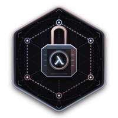

<p align="center">
  
</p>

# Hold Ledger · Verification

[](https://github.com/nshkrdotcom/hold_ledger)
[](LICENSE)

A payment processor can authorize a request even when its reply never arrives.
The ledger still needs to keep that money on hold. This Phoenix app lets you
follow that situation, explore the code, and read the claims that describe how
the ledger should behave.

Start with a 100¢ hold. In **Case Lab**, try inputs and propose different
outputs to see what a claim accepts. In **Claim Lens**, practice reviewing a
changed claim before revealing the explanation. Each path leads back to the
policy and source, so you can check the reasoning yourself.

The app explores a local model of one account. The catalog contains 49 claims:
35 Elixir laws translated through Lynx and 14 written directly in Lean.

## Run locally

Use the Elixir/OTP versions in the repository's `.tool-versions`, plus Python
and `uv` as described in [Getting started](https://github.com/nshkrdotcom/hold_ledger/blob/main/guides/getting-started.md).
Onboarding checks your existing Elixir/OTP installation and provisions the
pinned local proof tools. From the repository root:

```sh
uv sync --locked
uv run --locked python scripts/onboard.py --profile runtime --provision
uv run --locked python scripts/local_run.py --cwd apps/review_web mix deps.get --check-locked
uv run --locked python scripts/local_run.py --cwd apps/review_web mix assets.build
uv run --locked python scripts/local_run.py --cwd apps/review_web mix phx.server
```

Open [localhost:4000](http://localhost:4000) and choose **Follow a payment hold**.
Amounts are integer cents: `100` means $1.00.

## Try your first review

Open [exact-fit admission](http://localhost:4000/lens/po_a2). An account has
100¢ available and a free hold slot. A new request asks for all 100¢.

1. Read the policy and the claim's `requires` and `expects` clauses.
2. Compare the original claim with the proposed change. Which inputs does
   each cover?
3. Inspect **Code returned** and **Proposed output · not run**.
4. Choose a classification, then confirm it to reveal the worked explanation.
   If you are unsure, you can say so.

Then try the inputs just below and above the limit. The exercise is about
reading what a claim promises; you can leave the proof tactics for later.

## Find your way around

| What you want to do | Open |
|---|---|
| Follow a hold through a missing reply | [Payment walkthrough](http://localhost:4000/start) |
| Explore the components and hold states | [System](http://localhost:4000/system) |
| Read the six payment requirements | [Requirements](http://localhost:4000/guarantees) |
| Find a claim, its scenario, and source | [Claim catalog](http://localhost:4000/atlas) |
| Learn to read a statement and its proof | [Reading claims](http://localhost:4000/proofs) |
| Understand reports and external assumptions | [Evidence](http://localhost:4000/assurance) |
| Locate the relevant files | [Source map](http://localhost:4000/repository) |
| Look up an unfamiliar term | [Glossary](http://localhost:4000/glossary) |
| Run a case or compare source versions | [Case Lab](http://localhost:4000/lab) |
| Practice a review | [Claim Lens](http://localhost:4000/lens/po_a2) |

The catalog groups claims into eight families as a reading order. Each profile
starts with a concrete situation, the required result, and what could go wrong.
Source references show where the explanation comes from. Profiles live at
`/atlas/:slug`; working cases use `/claims/:slug` and `/claims/:slug/:id`.
Term explanations and page help are available throughout the app, with full
source and raw data nearby.

## Explore a case in Case Lab

Choose a claim and read its requirement summary. **Read full claim** opens the
actual `requires` and `expects`, or the native Lean declaration. Enter an
amount or use **1¢ less / All available / 1¢ more** to explore a boundary.

**Code returned** shows the computed Ledger result. **Proposed output · not
run** lets you ask whether the claim would accept a different answer. Edit the
result, reserved amount, hold status, or requested effects. A requested effect
describes outside work, such as sending a cancellation request.

The check table keeps three questions separate: does the claim cover this
input, does it accept the output, and does the account balance?

| Result | How to read it |
|---|---|
| Claim would accept this output. Intended? | Compare the proposed output with the policy. Acceptance alone does not establish a defect. |
| Claim rejects this output | The proposed output fails the claim for this input. |
| Claim says nothing about this input | The starting condition is false; inspect why the input is excluded. |
| No check wired up for this event | Read the source; this event has no supported probe. |
| Check unavailable | An observation is missing or failed. |

You can deliberately leave totals inconsistent. **Recalculate totals** changes
them only when requested. The JSON editor accepts up to eight entries and
integers up to 1,000,000. **Full differences** includes additions, removals,
ordering changes, and ambiguous matches. Invalid edits clear the previous
successful check.

Use **Run another event** to try dispatch, timeout, retry, cancellation, or
confirmation. Branch from a proposed output to explore its consequences, then
use **Run on both paths** to apply an event to both branches. For example,
release capacity early and try requesting it again.

## Practice with Claim Lens

Lens has two studies: [exact-fit admission](http://localhost:4000/lens/po_a2)
and [retention](http://localhost:4000/lens/po_exposure_retain). Each pairs a
policy passage with an actual claim, a concrete input, and a modeled change
to the claim. A proof-body-only example helps you distinguish a changed
argument from a changed promise.

**Review first** is the default. You can read the source before deciding;
worked verdicts, coverage comparisons, and explanations appear after you
confirm your classification. **Explore freely**, at
`/lens/:slug?mode=explore`, shows that feedback immediately.

An optional argument form asks you to connect the policy, claim, example, and
remaining assumption. After confirmation, you can copy it as Markdown. Your
classification and argument stay in the current page: they are not saved to
review notes or sent to a model. Changing the input, proposed change, study,
or mode clears the attempt, as do **Try again** and reloading.

After feedback, three further comparisons cover a missing void effect (P02),
premature release (P05), and cancellation before dispatch (P08). These worked
examples come from the review guide. Lens models fixed claim changes; it does
not edit source or check a revised proof.

## Read the source and evidence

Start with the conditions that explain the result. Expand the observed
expression tree for helper definitions, operands, and individual bindings.
Selecting a reviewed clause opens the related Lean passage; **Read full
proof** opens the complete source. Links are checked against the reviewed
source bytes. A missing, stale, or ambiguous link is marked unavailable.

| What you are looking at | What it establishes |
|---|---|
| Registered claim | The claim belongs to the catalog. |
| Single-case check | The claim's response to this particular input and output. |
| Source reading | A reviewed connection between Elixir and Lean text. |
| Focused elaboration | Lean elaborated the selected generated declarations for the recorded sources. |
| Accepted full verification report | The required checks passed for the source bytes and claim scope recorded in the report. |

A proof establishes its stated claim under its assumptions. Reviewing whether
that claim expresses the payment policy remains a separate task. **Assumptions**
lets you compare processor behavior, including whether cancellation remains
final. **Open coupled processor case** shows local knowledge alongside remote
authorization and delivery. The linked processor and runtime guides explain
the assumptions about real services and durable storage.

**Verification files** contains generated sources and matching reports. To
produce focused readings for the three primary worked claims, run from the
repository root:

```sh
MIX_ENV=test uv run --locked python scripts/local_run.py \
  mix run apps/review_web/scripts/produce_claim_readings.exs
```

Output goes to ignored `tmp/verification/claim-reading`. Full acceptance uses
the matching required-scope report and `ProofEvidence` validation described in
the [verification guide](https://github.com/nshkrdotcom/hold_ledger/blob/main/guides/verification.md).

## Save your work

Lab events remain temporary until you choose **Save to timeline**. **Reset**
discards the experiment; reloading also discards unsaved work. **Edit starting
state** creates a separate saved session.

Saving checks the session revision to catch changes from another tab. Commands
save individually. If a conflict interrupts a multi-step save, the page reports
what was saved and keeps the remaining steps unsaved.

Use **Flag concern**, **Open question**, or **Mark reviewed** to record a
review note, with optional context. The target identifies the claim and case;
when stored comparison evidence is selected, it identifies that finding.
Notes have their own revision checks and do not save pending events.

Open **Review notes** to read the history or export a session. **Download
local repair packet** appears when a selected source comparison has matching
evidence accepted by the packet validator. Source drift blocks stale
computations and exports. Notes and packets record review material; policy
approval and formal acceptance require their own evidence.

## Compare two source versions

From the repository root, stage each trusted local Git worktree:

```sh
python3 apps/review_web/scripts/stage_part3_snapshot.py \
  --source /absolute/path/to/trusted/worktree \
  --destination /absolute/path/to/hold_ledger/tmp/review_studio/snapshots
```

Provision compatible pinned dependencies offline in each snapshot's ignored
`tmp/part3_build` directories. In Lab, **Compare versions** selects the snapshots
by content identity. **Run on both versions** evaluates the active input in
separate BEAM processes. The opening **Example change** is a built-in
illustration.

Read input coverage, acceptance of a proposed output, and execution differences
separately. Finding no difference in the tried cases does not establish
equivalence. Use trusted source: process isolation prevents module mixing but
does not sandbox hostile code. The browser neither installs dependencies nor
accepts executable uploads.

## Ask Codex about a case

Type a question and press **Ask Codex** or Enter to send it immediately with
the displayed case and source. On smaller screens, open **Ask** and press
**Send to Codex**. Each submission authorizes that question and its displayed
context.

Before sending, use **Shares case + source** and **Context** to inspect the
exact prompt and packet. It includes the selected input/output, policy,
Ledger/Spec, runtime and processor documentation, and active claim and Lean
excerpts. Private review notes are excluded. Oversized or stale packets are
refused.

The completion adapter uses your existing Codex authentication and requests
`gpt-6.1-terra` with medium reasoning. It has no editing or shell tools and uses
no fallback provider. Answers appear beside the case, with source links and
reported response metadata. They are generated explanations; the evidence
panels remain the place to check proof results.

**History** searches local questions and reopens answers without a provider
call. You can copy or export a question, submit a follow-up with its historical
case, or choose **Ask using current case**. Typing, inspecting context, recalling
history, and reloading send nothing. Question actions do not save pending
events or change review notes.

Prompts, source context, answers, errors, and request events are stored in
ignored `tmp/review_studio/questions/<trace-id>/events.jsonl`, with owner-only
permissions. Logs exclude credentials and private provider reasoning. A log
failure prevents dispatch; a response-save failure is shown. Cancel, timeout,
and restart do not resend automatically. **Clear history…** confirms before
deleting question logs. Deletion is refused while a question is running.

## Use the command interface

Write a JSON request file, then run this from the repository root:

```sh
uv run --locked python scripts/local_run.py --cwd apps/review_web \
  mix run --no-start scripts/explore.exs -- /absolute/path/to/request.json
```

Read a claim:

```json
{"operation":"read_claim","slug":"po_exposure_retain"}
```

Run a request through the ledger:

```json
{"operation":"step","mode":"ledger","before":{"amount_limit":100,"hold_limit":2,"used_amount":0,"used_holds":0,"entries":[]},"event":{"type":"request","key":11,"amount":100}}
```

For clause observations, use `explain_claim` with a `slug` and a `witness`
containing complete `before`, `event`, and `output` values. The command uses
the same evaluator and source readings as the screen, in its own scratch
store. Request files are limited to 64,000 bytes. It opens no HTTP listener
and makes no model request.

## Check changes

From the repository root:

```sh
uv run --locked python scripts/local_run.py mix test test/claim_source_parity_test.exs
uv run --locked python scripts/local_run.py mix test --exclude laws
uv run --locked python scripts/local_run.py --cwd apps/review_web mix test test/hold_ledger_review/claim_lens_test.exs test/hold_ledger_review_web/claim_lens_live_test.exs
uv run --locked python scripts/local_run.py --cwd apps/review_web mix precommit
uv run --locked python scripts/local_run.py --cwd apps/review_web mix docs --warnings-as-errors
uv run --locked python scripts/local_run.py --cwd apps/review_web mix assets.build
python3 -m unittest discover -s apps/review_web/scripts -p 'test_*.py' -v
```

`precommit` runs compilation with warnings treated as errors, formatting,
strict Credo, Dialyzer, and Phoenix tests.

With Phoenix running, use a separate terminal for browser checks:

```sh
cd apps/review_web/test/browser
npm ci
npx playwright install chromium
npm test
```

Supply real compatible `PART3_TEST_BASELINE_ID` and `PART3_TEST_PROPOSAL_ID`
values for the isolated-source comparison case. Lens checks live in
`test/browser/0810_claim_lens.spec.cjs`.

For help interactions, run `npm run test:presentation` from the browser-test
directory. It loads the app's help JavaScript and glossary into local browser
fixtures. These checks need no Phoenix server; the normal `npm test` suite
exercises the rendered LiveView screens.

From the browser-test directory, `npm run test:questions` starts and stops its
own controlled Phoenix fixture on port 4001. It checks question submission and
local persistence without provider calls; it does not measure live answer
quality.

## License

Released under the [MIT License](LICENSE).
